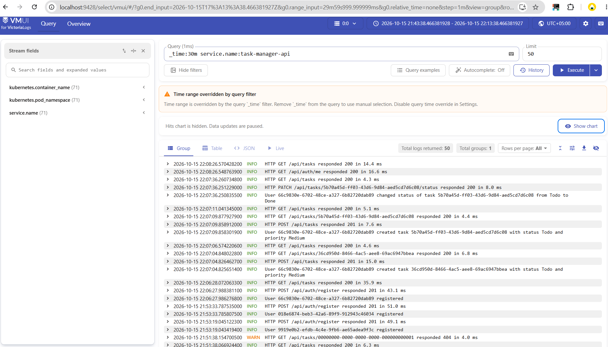
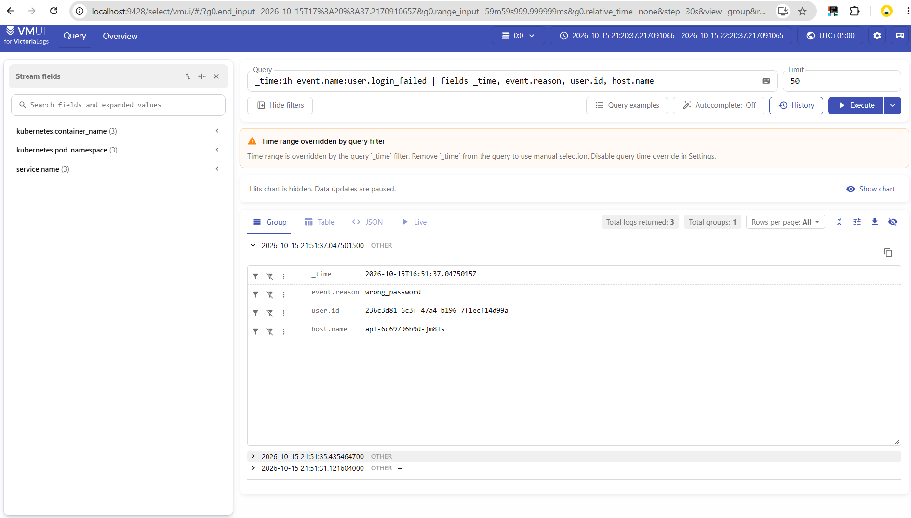
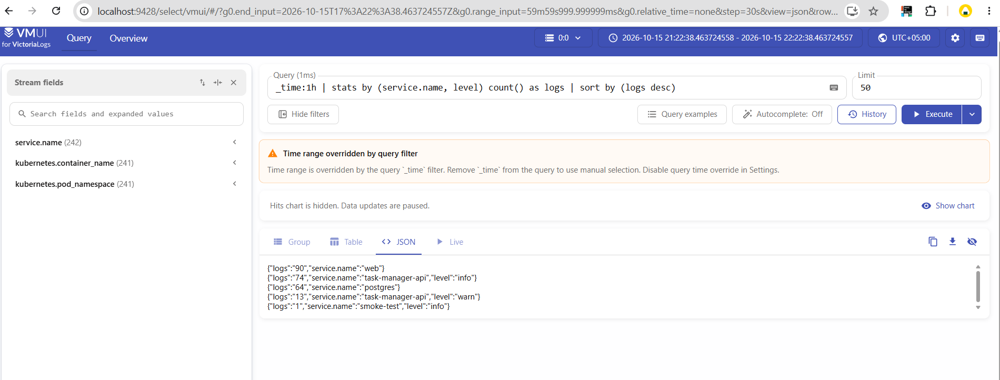
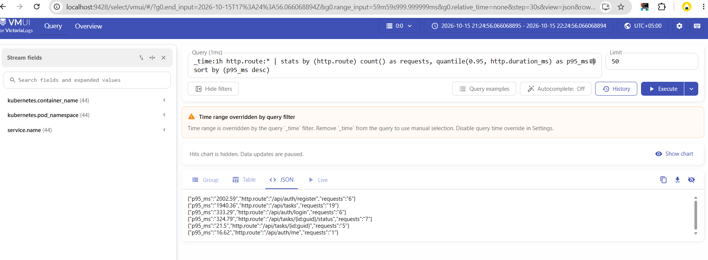

# Отчёт VictoriaLogs

Логи приложения Task Manager собираются в VictoriaLogs, развёрнутом в этом же кластере. Манифесты лежат в `k8s/observability/`.

## 1. Логи приложения в JSON

API пишет в stdout одну JSON-строку на событие с полями `timestamp`, `level`, `message`, `service.name`, а также `event.name`, `user.id`, `http.*`, `trace_id` и др. Схема полей и список событий — в разделе 8 файла `Отчёт.md`.

## 3. Доставка логов

Логи доставляет агент Vector, развёрнутый как DaemonSet: на каждой ноде он читает файлы логов подов приложения из `/var/log/pods`, разбирает JSON-строки в отдельные поля, добавляет метаданные куба и отправляет пачками в VictoriaLogs через `/insert/jsonline`.
Я выбрал такой способ, потому что в таком случае приложению нет необходимости знать о способе доставки и месте хранения логовю - разделение ответственности.

1. Сырые записи за последние 30 минут:

2. Фильтр по полю event.name, смотрим неудачные входы пользователей:

3. Статистика по service.name и level, количество запросов в разные части приложения:

4. Агрегирующий запрос - 95-й перцентиль времени ответа от API, самые медленные эндпоинты. Группируем по http.route, поэтому запросы к разным задачам попадают в одну группу. Медленнее всех получился /api/auth/register: p95 около 2 секунд. Хеширование пароля долгое.

